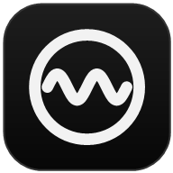

<p align="center"></p>

<h1 align="center">HUM для iPhone</h1>

<p align="center">Веб-версия <a href="https://github.com/qDoza/hum">HUM</a>: Яндекс Музыка и SoundCloud в одном приложении на экране «Домой».</p>

## Что умеет

- **«Мой эфир»** в одно нажатие. Для Яндекса HUM отправляет сервису отметки «дослушал / пропустил / не нравится», поэтому рекомендации учатся.
- **Миксы Яндекса:**
  - настроение задаётся графиком: тянете точку;
  - готовые миксы по настроению, характеру и языку;
  - подборки: Фокус, Вечеринка, В дорогу и другие;
  - «Занятия» от самого сервиса.
- **Эфир SoundCloud** с фильтрами: основа (лайки, свежие, давние, текущий трек), жанр, «без длинных сетов», «только незнакомое», «свежее за год».
- **Общее «Любимое»:** лайки обоих сервисов в одном списке с пометками `ЯМ` и `SC`, фильтр и поиск.
- **Поиск песен.** Лайк из результатов сразу попадает в «Любимое».
- **Полноэкранный плеер:** большая обложка и текст песни, синхронизированный текст подсвечивает текущую строку.
- **Экран блокировки и Пункт управления:** обложка, пауза, переключение и перемотка.

## Как устроено

Браузер не может напрямую обращаться к API Яндекс Музыки и SoundCloud: у них нет CORS. Поэтому рядом с приложением работает небольшой **Cloudflare Worker**, который пересылает запросы.

```
iPhone (PWA) ──/api/*──▶ Cloudflare Worker ──▶ api.music.yandex.net / api-v2.soundcloud.com
     └──────────── аудио напрямую ───────────▶ хранилища Яндекса / CDN SoundCloud
```

- **Токены** хранятся только на телефоне (`localStorage`) и приходят в Worker заголовками с каждым запросом. Worker ничего не сохраняет и не пишет в лог.
- **Звук** телефон берёт напрямую из хранилищ. Safari сам проигрывает mp3 Яндекса и HLS-потоки SoundCloud. Если прямая ссылка не открывается, звук идёт через `/api/pipe`, где разрешены только хосты хранилищ.

| Путь | Что там |
|---|---|
| `worker/index.js` | прокси к API, подписанные ссылки на mp3 Яндекса, тексты, `client_id` SoundCloud |
| `public/app.js` | приложение: аккаунты, лайки, эфиры, миксы, плеер, Media Session |
| `public/app.css` | оформление в стиле десктопного HUM |
| `public/sw.js` | кэш оболочки для мгновенного запуска |

## Развернуть у себя

Нужны [Node.js](https://nodejs.org) и бесплатный аккаунт Cloudflare.

```bash
git clone https://github.com/qDoza/hum-web.git
cd hum-web
npm install
npx wrangler login
npm run deploy
```

Wrangler выдаст адрес вида `https://hum.<ваш-поддомен>.workers.dev`. Для локальной разработки: `npm run dev`.

## Подключить аккаунты

1. В десктопном HUM нажмите кнопку с человечком → **«Подключить iPhone»** и отсканируйте QR-код камерой iPhone. В HUM на ПК адрес веб-версии задаётся в `%APPDATA%\Hum\settings.json` (`WebAppUrl`).
2. Либо введите токены вручную: в приложении кнопка с человечком → «Ввести токен вручную».
3. В Safari: «Поделиться» → **«На экран „Домой“»**.

Токены передаются в части ссылки после `#`, а браузер её на сервер не отправляет. QR-код никому не показывайте.

## Ограничения iOS

- Сайтам нельзя менять громкость, она регулируется кнопками телефона.
- Первый запуск музыки нужно сделать нажатием, дальше треки переключаются автоматически, в том числе в фоне.

## Отказ от ответственности

Неофициальный проект, не связан с Яндексом и SoundCloud и ими не одобрен. Приложение пользуется внутренним API Яндекс Музыки и веб-API SoundCloud, которые могут измениться в любой момент. Музыка и тексты берутся из сервисов под вашим аккаунтом и нигде не сохраняются. Пользуйтесь в соответствии с правилами этих сервисов.
